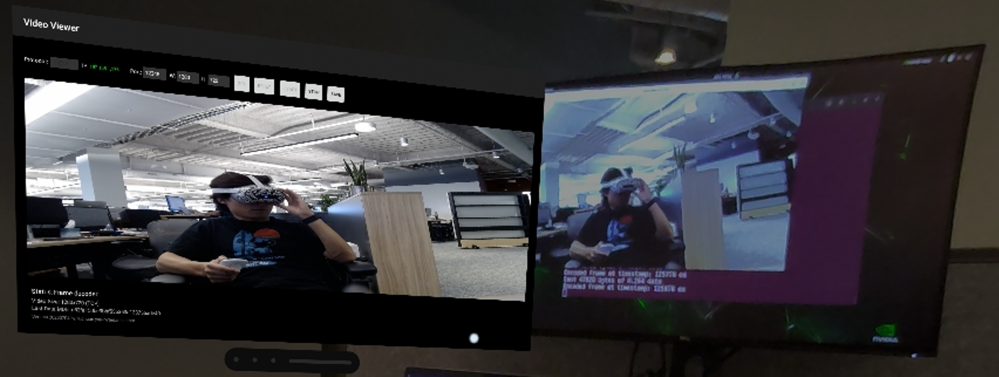

# XRoboToolkit-Orin-Video-Sender
Video Previewer/Encoder/Sender on Nvidia Jetson Orin Platform


> Sender (Webcam): `./orinvideosender2 --preview --send --server 192.168.1.176 --port 12345`

> Receiver (Video-Viewer): TCP - 192.168.1.176 - 12345 - 1280x720

## Features

- Support Webcam and ZED cameras
- Preview
- H264 Encoding (via GStreamer)
- TCP/UDP sending w/ and w/o ASIO


## How to

- Setup necessary environment on Orin
```
# Unitree G1 Orin NX / JetPack 5.x
make install-deps

# Provided by JetPack / L4T and ZED SDK; verify before building/running:
make check-jetson-deps
```

- Build
```
# Update `Makefile` to choose the protocol [TCP/UDP], camera type [Webcam/ZED], w/ or w/o ASIO.
# Default for G1 Orin NX: ZED TCP sender with ZMQ raw/encoded support.

make

# This low-latency build installs/runs as orinvideosender2 so it does not
# collide with an existing OrinVideoSender installation.
./orinvideosender2 --help

# Listen to coming command from VR, 192.168.1.153 is the Orin IP address
# Add `--preview` to show the video on Orin if necessary
./orinvideosender2 --listen 192.168.1.153:13579 --codec h264

# Send the H.264 stream to both VR via TCP and a local subscriber via ZMQ
./orinvideosender2 --listen 192.168.1.153:13579 --codec h264 --zmq tcp://*:5555

# Direct send the video stream # 192.168.1.176 is the VR headset IP
# Add `--preview` to show the video on Orin if necessary
./orinvideosender2 --send --server 192.168.1.176 --port 12345 --codec h264
```

> Note: `orinvideosender2` is the opinionated low-latency build. The legacy
> `--legacy-pipeline` (CPU `videoconvert` shim) and `--zmq-raw` (raw side-by-side
> BGRA publisher) paths have been removed. Keep the original `OrinVideoSender`
> binary if you still need either of those.

## G1 Orin NX low-latency notes

- Default ZED view is side-by-side (`--view sbs`) for the existing PICO XRoboToolkit Unity client.
- `--view left` is available for mono testing only; PICO stereo expects SBS unless Unity is changed.
- The pipeline is `BGRA appsrc -> nvvidconv -> NVMM/NV12 -> nvv4l2h264enc -> h264parse -> appsink`.
- Remaining CPU copy: ZED CPU BGRA image into the `appsrc` buffer. Color conversion and H.264 encode stay on Jetson hardware.
- Low-latency mode sets available encoder properties at runtime: max performance, SPS/PPS insertion, CBR, IDR/I-frame interval, and no B-frames where supported.
- Timing logs report grab, retrieve, appsrc copy/push, encode-to-appsink, TCP send, ZMQ send, FPS, and drops every `--stats-interval` frames.
- The earlier hand-rolled NVMM/dmabuf attempt in `main_zed_zero_copy.cpp` is kept for reference only — it broke the Jetson NVMM contract (wrong `NVBUF_MEM_*` mode, missing `NvBufSurface` meta on the `GstBuffer`) and never produced a valid encoder input. A real GPU/NVMM path would need the Jetson Multimedia API directly, or a custom GStreamer element that produces proper L4T-tagged buffers.

## One More Thing 

- For software encoding ffmpeg, please refer to [RobotVisionTest](https://github.com/XR-Robotics/RobotVision-PC/tree/main/VideoTransferPC/RobotVisionTest).

> Note: Hardware ffmpeg encoding is not availalbe yet.

> Note: Jetson Multimedia API is not in use yet.

- For encoded h264 stream receiver, please refer to [VideoPlayer](https://github.com/XR-Robotics/RobotVision-PC/tree/main/VideoTransferPC/VideoPlayer) [TCP Only].

- For a general video player, please refer to [Video-Viewer](https://github.com/XR-Robotics/XRoboToolkit-Native-Video-Viewer) [TCP/UDP].

- The encoded h264 stream can be also played in [Unity-Client](https://github.com/XR-Robotics/XRoboToolkit-Unity-Client) [TCP Only].
